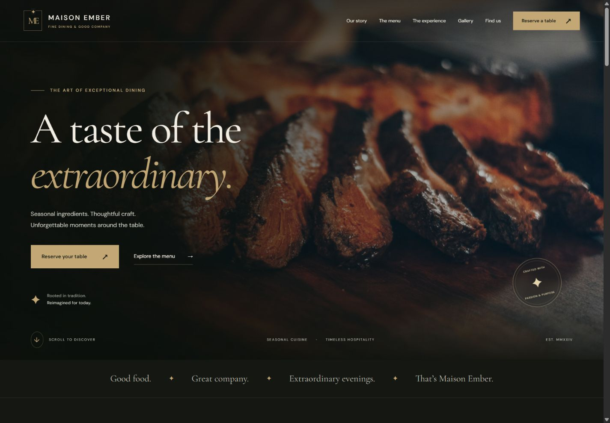
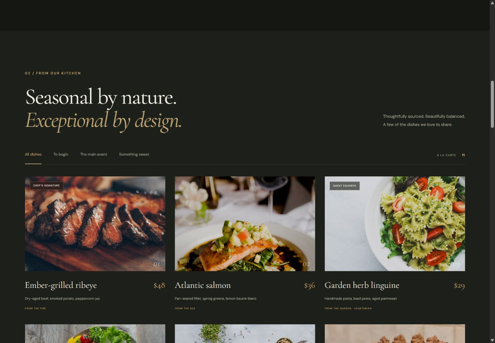
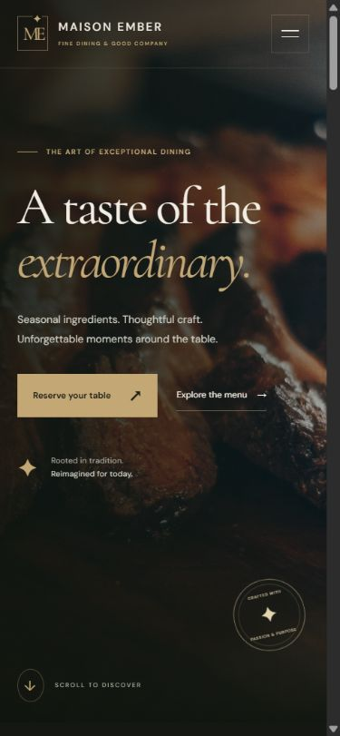

# Premium Restaurant Landing Page

### Maison Ember — A taste of the extraordinary.

A luxury restaurant website concept built with **HTML, CSS, and vanilla JavaScript**. Maison Ember pairs cinematic food photography with expressive typography, charcoal surfaces, muted gold accents, and carefully paced editorial sections.

Designed as a freelance front-end portfolio project, it demonstrates a complete restaurant landing page with thoughtful responsive layouts and practical, accessible interactions.

## Live Demo

**[Visit Maison Ember](https://aliamr8495-cpu.github.io/premium-restaurant-landing-page/)**

**[View the source on GitHub](https://github.com/aliamr8495-cpu/premium-restaurant-landing-page)**

The project is configured for GitHub Pages using the `main` branch and the repository root. No build step is required.

## Screenshots

### Desktop — the opening experience



### Menu — seasonal dishes



### Mobile — a considered responsive layout



## Project Overview

Maison Ember is a fictional fine-dining brand created to showcase the design and development of a premium hospitality website. The page guides visitors from the restaurant story and signature dishes to the dining experience, gallery, reservation form, and contact information.

The implementation focuses on visual hierarchy, consistent spacing, image composition, responsive grids, readable typography, and subtle interaction feedback. Everything runs directly in the browser without a framework or application server.

## Technologies Used

| Technology | Purpose |
| --- | --- |
| HTML5 | Semantic page structure, native form controls, accessible landmarks |
| CSS3 | Design tokens, responsive Grid and Flexbox layouts, transitions, glass effects |
| JavaScript (ES6+) | Mobile navigation, menu filters, reviews, gallery dialog, form validation |
| Google Fonts | Cormorant Garamond and DM Sans typography |
| Font Awesome Free | Consistent interface and feature icons |
| GitHub Pages | Static hosting from the `main` branch |

## Features

- Cinematic hero with clear reservation and menu calls to action.
- Editorial restaurant story with layered photography.
- Six featured dishes with images, prices, and category filters.
- Four feature cards describing the dining experience.
- Manually controlled testimonial carousel with accessible announcements.
- Responsive gallery with a native modal image viewer and Escape-to-close behavior.
- Reservation form with required-field, email, date, Monday closure, and Sunday dining-time validation.
- Contact information, opening hours, and an original illustrated map placeholder.
- Mobile navigation with keyboard focus handling and Escape-to-close behavior.
- Smooth anchor navigation, image hover treatments, and one-time scroll reveals.
- Reduced-motion support, visible focus states, a skip link, and descriptive image text.
- Search-friendly title, description, semantic headings, theme color, and a custom favicon.
- Local restaurant photography with documented asset sources.

## Run Locally

1. Clone the repository:

   ```bash
   git clone https://github.com/aliamr8495-cpu/premium-restaurant-landing-page.git
   cd premium-restaurant-landing-page
   ```

2. Open `index.html` in a modern browser, or serve the folder with your preferred static development server, such as VS Code Live Server.

There are no dependencies to install and no build commands to run. Google Fonts and Font Awesome are loaded from external services, so an internet connection is required for those resources.

## Project Structure

```text
premium-restaurant-landing-page/
├── index.html
├── style.css
├── script.js
├── images/                    # Local restaurant and food photography
├── assets/
│   ├── favicon.svg
│   └── screenshots/           # Real browser captures used in this README
├── .gitignore
├── .nojekyll
├── ASSET-CREDITS.md
└── README.md
```

## Customization

- Update the brand name, copy, menu, contact details, and hours in `index.html`.
- Change the palette, typography, and layout tokens in `:root` in `style.css`.
- Replace photos in `images/` and update the corresponding alternative text and credits.
- Adjust the illustrative reviews and reservation behavior in `script.js`.
- Keep reservation validation aligned with the published opening hours.

## Demo Scope

This is a front-end portfolio concept. The restaurant, contact details, and guest reviews are illustrative. The map is an intentional graphic placeholder. The reservation form validates input and displays a sample request summary; it does **not** send email, store personal information, check table availability, or confirm a booking. A live restaurant would need its real content and a connected reservation service before accepting customer requests.

## Asset Credits

Photography sources, font references, and icon licensing information are listed in **[ASSET-CREDITS.md](ASSET-CREDITS.md)**. Third-party assets retain their respective licenses.

## Author

Created and maintained by **[aliamr8495-cpu](https://github.com/aliamr8495-cpu)** as a freelance web development portfolio project.

For project enquiries, visit the author's GitHub profile.
